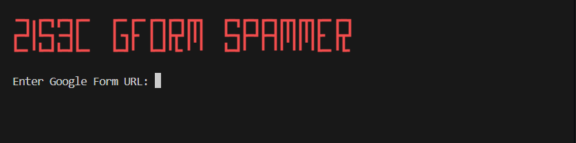

# FormForge


<p align="center">
  
</p>

📺 **Video Tutorial:** [**Watch how to use the repo here**](https://www.youtube.com/watch?v=WCD-5lONJO4)

FormForge is an asynchronous Google Forms automation and load-testing tool built with Python and `aiohttp`. It parses a form's public structure, generates synthetic responses — fully random, or weighted per option with exact quotas — and submits them with configurable concurrency, retry/backoff on rate limits, and per-run statistics. The same workflow is available in a browser UI and a CLI.

> [!WARNING]
> **Authorized testing only.** Use FormForge only on forms you own or have explicit permission to test. Automated submissions against third-party forms violate Google's Terms of Service and can permanently distort real survey data. The authors are not responsible for any misuse.

## Features

- 🚀 **Async engine**: `aiohttp` worker pool with configurable concurrency.
- ⚖️ **Weighted pools & quotas**: per-option weights plus run-wide quotas for exact distributions, and `__pick` for checkboxes and grid rows.
- 📝 **Presets**: JSON files (`url`, `count`, `workers`, `config`) that drive `main.py --preset`; export/import from the web UI.
- 🖥️ **Web UI**: parse the form, configure every question, run, watch live progress over SSE, cancel mid-run — browser only, no CLI needed.
- 🤖 **Auto-discovery**: parses Short Answer, Paragraph, Multiple Choice, Dropdown, Checkboxes, Linear Scale, Multiple Choice Grid, Date, and Time questions, including multi-page forms (correct `pageHistory` for every page).
- 🇮🇩 **Identitas Indonesia**: jawaban teks memakai satu profil konsisten per respons (nama, email, telepon, NIK, alamat, pendidikan) dari 2000 nama unik.
- 🛡️ **Resilience**: automatic retry with exponential backoff for 408/429/5xx, User-Agent rotation.
- ✅ **Verified submissions**: every HTTP 200 is checked against Google's confirmation page; a rejected or closed form counts as a failure, not a success.
- 🧾 **Run report**: `--report run.jsonl` logs every attempt (answers, verdict, error), and the CLI prints a quota target-vs-sent check when the run ends.
- 💻 **CLI & interactive**: fully scripted via arguments or guided prompts with `rich` panels.

## Installation

1. **Clone the repository**
   ```bash
   git clone https://github.com/BadryansahBangsawan/form-forge
   cd form-forge
   ```

2. **Install dependencies**
   ```bash
   pip install -r requirements.txt
   ```

## Project Structure

```
form-forge/
├── main.py                 # Main CLI - entry point for all modes
├── core.py                 # Async engine - form parsing, response generation, submissions, JSONL report
├── identity.py             # Indonesian profile and question-aware text answers
├── id_data.py              # Name, address, and education banks behind identity.py
├── configurator.py         # CLI-integrated configurator (launched from interactive mode)
├── webapp.py               # Standalone web app - the whole flow runs in the browser
├── web/index.html          # Single-page UI served by webapp.py
├── preset_*.json           # Your presets (gitignored; export from the web UI)
├── test_core.py            # Offline checks: response classification and JSONL report
├── test_identity.py        # Offline checks: profile consistency and field validation
├── test_preset.py          # Offline checks: quota sums and distributions for preset_*.json
├── requirements.txt        # Python dependencies
├── preview.png             # CLI/dashboard preview screenshot
├── TOOL_DOCUMENTATION.md   # Capabilities and awareness guide
└── CONTRIBUTING.md         # Contribution guidelines
```

## Usage

### Interactive Mode
Simply run the script without arguments:
```bash
python main.py
```
Follow the prompts to enter the Form URL. You can choose between:
1. **Random Generation**: Automatically fills fields with plausible data.
2. **Custom Config**: Launches a local Web UI to visually configure specific answers for every question.

### Web App (browser only)
```bash
python webapp.py            # opens http://127.0.0.1:8000
```
Paste the form URL, press **Parse**, then per question tick the options that may be used and set a weight/quota for each. Leave a question untouched to keep it fully random. Set the response count and workers, press **Mulai**, and watch live progress. **Export preset** downloads a JSON file that `main.py --preset` accepts; **Import preset** fills the UI from one.

Options: `--host`, `--port` (default `8000`), `--no-browser`. The web app accepts 1–100,000 responses and 1–200 workers, allows one run at a time, and rejects POSTs from other origins. It has no authentication, so binding `--host` to anything other than loopback exposes it to your network; the server prints a warning when you do.

Quota totals per question must equal the response count for an exact distribution; the panel warns in amber when they differ.

### Command Line Interface
To see all available options:
```bash
python main.py --help
```

**Example:**
```bash
python main.py --url "https://docs.google.com/forms/d/e/..." --count 1000 --workers 100
```

| Argument | Description | Default |
|----------|-------------|---------|
| `--url` | The full URL of the Google Form | - |
| `--count` | Number of responses to send | `100` |
| `--workers` | Number of concurrent async workers | `50` |
| `--custom-answer` | Custom text for open-ended questions | Random |
| `--preset` | JSON preset with weighted pools/quotas (export one from the web UI) | - |
| `--report` | JSONL log of every submission attempt, plus quota summary at the end | - |
| `--help` | Show the help message and exit | - |

CLI values you pass explicitly override the preset; otherwise `count` and `workers` come from the preset file.

### Presets

A preset is a JSON file shaped like:

```json
{
  "url": "https://docs.google.com/forms/d/e/.../viewform",
  "count": 44,
  "workers": 10,
  "config": {
    "entry.123__pool": [{"value": "Badminton", "weight": 1, "quota": 14}],
    "entry.456__pick": 1,
    "entry.789": "fixed answer"
  }
}
```

- `<qid>__pool`: list of `{value, weight, quota}`; quotas are enforced across the whole run. A `weight` of `0` keeps an option listed but never picked.
- `<qid>__pick`: how many options a Checkboxes question, or a Multiple Choice Grid row, picks per response (clamped to the number of options).
- `<qid>` (bare): a fixed answer for every response.

Run `python test_preset.py` to verify quota sums and distributions offline before submitting anything.

## Tests

Three offline scripts, no pytest and no network:

```bash
python test_core.py       # response classification and the JSONL report
python test_identity.py   # profile consistency and field validation
python test_preset.py     # quota sums and exact distributions for preset_*.json
```

Each exits non-zero on failure. `test_core.py` starts a throwaway local aiohttp server. `test_preset.py` accepts explicit paths (`python test_preset.py preset_40.json`) and otherwise checks every preset in the repository root; it needs at least one, and presets are gitignored, so a fresh clone has none to check.

## Verification and Report

An HTTP 200 from `formResponse` only proves Google answered; it does not prove the response was stored. FormForge reads that page and classifies it:

| Response body | Outcome |
|---------------|---------|
| Confirmation page (`freebirdFormviewerViewResponseConfirmationMessage`) | success, verified |
| The form page again, or a required-question error | failure, "Jawaban ditolak" |
| "No longer accepting responses" | failure, form closed |
| Anything else | success, counted as `unverified` |

Rejected and closed responses are deterministic, so they fail immediately instead of burning retries. `unverified` is reported separately in the CLI summary and the web UI, so a run never hides what it could not prove.

Pass `--report` to keep an auditable log:

```bash
python main.py --url "https://docs.google.com/forms/d/e/..." --count 100 --report run.jsonl
```

The file is JSONL with a `run_start` line, one `response` line per attempt (`n`, `at`, `ok`, `verified`, `error`, `answers`), and a `run_end` line with the totals. `verified` is `recorded`, `closed`, `rejected`, or `unknown`. It opens in append mode, so several interactive batches can share one file. At the end of a run the CLI also compares each configured quota with the number of accepted answers and prints only the mismatches.

## How It Works

1. **Parsing**: Fetches the form HTML and extracts the `FB_PUBLIC_LOAD_DATA_` JSON blob plus hidden fields (`fbzx`, `fvv`, `pageHistory`), identifying all questions and pages.
2. **Generation**: Answers are generated from weighted pools (quota-aware) or plausible random data per question type.
3. **Submission**: An async worker pool POSTs to the `formResponse` endpoint concurrently, with retry/backoff on rate limits.
4. **Monitoring**: Real-time progress bar and stats (Success/Fail/Retries/Unverified) via `rich`, or live SSE events in the web UI. Every 200 response is classified before it counts as a success.

## Limitations

- Works only against **public, anonymous** forms. Forms requiring sign-in, verified email collection, file uploads, or one-response-per-account reject every submission.
- Verification is heuristic: it recognises the standard confirmation page, closed-form page, and re-rendered form page. A form with an unusual response page is counted as `unverified` rather than failed. Always confirm the response sheet on a `count=1` dry run before scaling.

## Contributing

Contributions are welcome! Please see [CONTRIBUTING.md](CONTRIBUTING.md) for guidelines on reporting bugs, suggesting enhancements, and submitting pull requests.

## License

This project is licensed under the MIT License - see the [LICENSE](LICENSE) file for details.